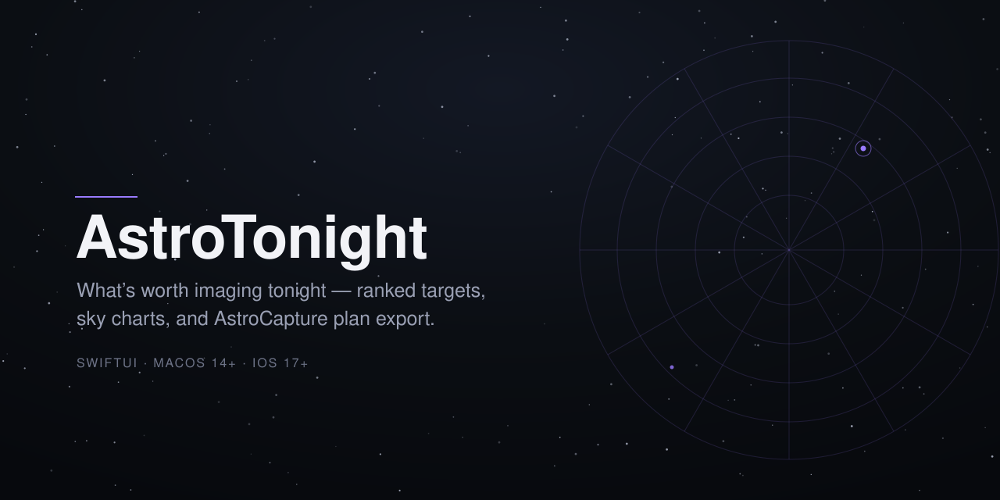
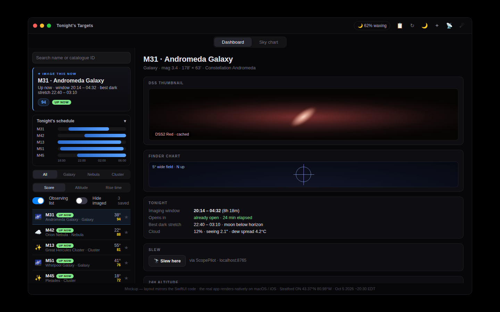
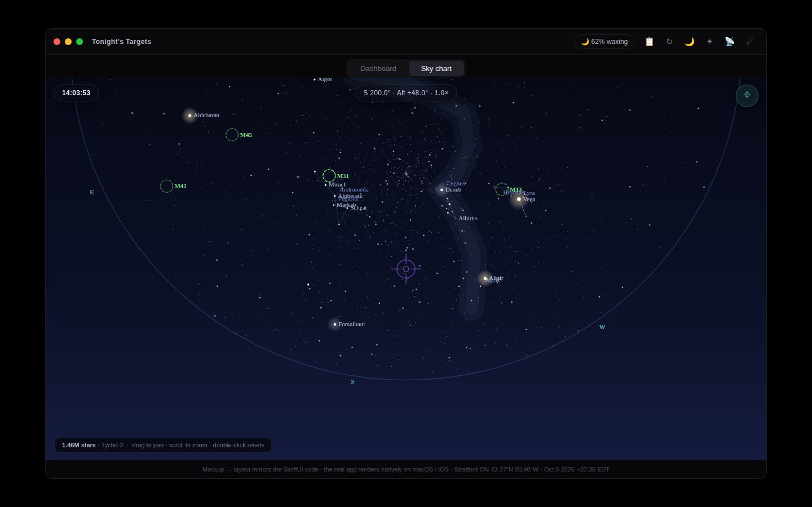
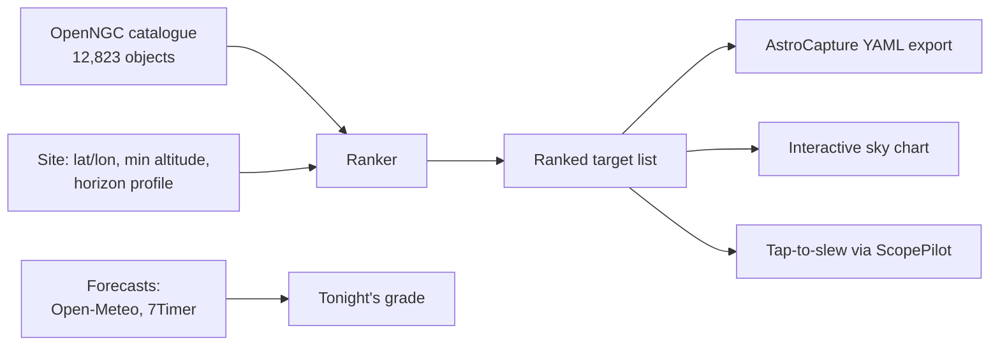

<p align="center">
  
</p>

<p align="center">
  
  
  
  
</p>

# AstroTonight

**What's worth imaging tonight — ranked targets, sky charts, and AstroCapture plan export.**

AstroTonight is a native SwiftUI companion for [AstroCapture](https://github.com/Skeleten80/astro-capture) on macOS and iOS/iPadOS. It loads the same vendored 12,823-object night-sky catalogue (OpenNGC, CC-BY-SA-4.0) and ranks what's best placed tonight for your site — no Python, no terminal, just a list you can browse with coffee. One universal iOS target covers iPhone and iPad.

> **Status: not yet compiled.** The Swift is written and hand-reviewed but has never seen a compiler — there is no Xcode on the build machine. The iMac build is the pending gate. The ranking logic itself is validated: a Python mirror of the hot loop ranks all 12,823 objects × 145 time steps in 0.26 s. If Xcode reports a build error, that's a real bug — report it and it gets fixed.

## Screenshots

These are the **approved design mockups** the SwiftUI views implement — not screenshots of the running app (see status above).

| Dashboard | Sky chart |
|---|---|
|  |  |
| Ranked target list, tonight's grade, weather strip, night timeline | Interactive planetarium chart with time scrub and FOV indicator |

## Features

- **Ranked target list** — peak altitude first, then hours above your minimum altitude. Identical ordering to `astrocapture tonight` (same algorithm, same catalogue).
- **Sky chart** — interactive planetarium chart for your site and time: stereographic projection, drag to pan, pinch to zoom, ~1.46 M Tycho-2 stars (V < 11.5) magnitude-scaled, 89 constellation lines, ranked targets as markers, tap-to-select. Night-vision red mode covers it too.
- **Time scrub** — a SkySafari-like footer scrubs the chart ±12 h in 0.25 h steps, with a "Now" button. Chart-only: ranking, windows, and grades stay on real time.
- **FOV indicator** — the selected rig's sensor frame drawn as a thin rectangle on the chart, centred on your selection. Follows the time scrub.
- **Planets** — Mercury through Neptune computed in-app from Paul Schlyter's public-domain algorithm (no network needed): chart markers plus a sidebar section with altitude and rise/set. Good to ~1′, fine for finding them.
- **AstroCapture export** — "Copy scheduler YAML" produces a `targets:` block for your plan YAML (ranking carries over as `priority`); the observing list exports a full multi-target night plan in one shot.
- **Tonight's grade** — a single A–F answering "is tonight worth setting up?", graded from cloud cover, seeing, moon, and dark hours. Every deduction itemized.
- **Imaging windows** — each target's best contiguous stretch above your minimum altitude *and* in astronomical darkness, with live "opens in 2h" / "open now" / "closed" status.
- **Session log** — per-night exposure logging with running integration totals, per-target hour goals, and Markdown export.
- **Satellites & comets** — ISS / bright-satellite passes (SGP4, CelesTrak TLEs) and bright comets (MPC elements; STALE banner past 30 days).
- **Tap-to-slew** — POSTs coordinates to [ScopePilot](https://github.com/Skeleten80/scopepilot)'s `/api/goto`.
- **Moon awareness** — illumination and phase names, per-target separation verdicts, moonrise/set, and a 30-day moon planner strip.
- **Forecasts** — Open-Meteo cloud strip and 7Timer seeing/transparency in the sidebar; dew-point spread with a "heater on" warning.
- **Night-vision mode** — red overlay toggle so the app doesn't wreck your dark adaptation at the scope.

<details>
<summary>Full feature list</summary>

- **Live "up now" badges** — each row shows current altitude and whether the target is above your minimum, low, or below the horizon. Refreshes every minute.
- **Search + type filter** — by name or catalogue ID (M51, NGC 7000…), grouped into Galaxies / Nebulae / Clusters / Other.
- **Detail view** — rise/set/peak times, hours above minimum, current alt/az, a 24-hour altitude chart with your minimum-altitude line and a now-marker, one-click copy of J2000 coordinates (or a hand-controller-friendly `13h 29m 53s  +47° 11' 43"` string for the NexStar).
- **Fits-my-rig framing** — each target checked against your rig preset (default T7i + stock 6SE at 1500 mm f/10): a badge (fits with room / fills the frame / tight / mosaic target) plus a to-scale sensor-rectangle diagram. Rig presets for the f/6.3 reducer and custom rigs in Site settings.
- **Dark hours** — astronomical dusk → dawn for your site in the sidebar, per-target "dark time above minimum", and the altitude chart keeps its minimum-altitude line.
- **Observing list** — star picks from the list or detail view; filter to the list with a toggle. Saved between launches.
- **Best night this week** — each target gets a 7-night scan (peak altitude + moon at peak); the best night highlighted, moon-clear first.
- **Field-rotation hint** — alt-az reality check at the target's peak: rotation rate in °/hr and estimated corner trailing in a 30 s sub.
- **DSS preview** — Digitized Sky Survey (DSS2 Red) cutout per target from NASA SkyView, fetched on demand and cached (~200 MB cap).
- **Finder chart** — ~3° DSS2-colour wide-field cutout (CDS hips2fits) for star-hopping context.
- **Horizon profile** — survey your real horizon (azimuth/altitude points) and the ranking, windows, and badges respect your trees and roofline.
- **Sort options** — Rank, Peak time, Window opens, or A–Z.
- **Field-ready observing plan** — "Copy observing plan" copies a Markdown plan for tonight: site, dark window, moon, rig, cloud summary, per-target windows and framing.
- **Window-open notifications** — opt-in per target; notifies 30 min before the imaging window opens (scheduled while the app runs, max 8 pending).
- **Pre-session checklist** — dew heater, battery, GoTo alignment…, tappable with your own add/remove/reset. Readable under night-vision mode.
- **Custom target import** — CSV (`name, ra, dec` in decimal degrees) targets that rank, chart, and export like catalogue objects.
- **Tonight's schedule** — Gantt-style timeline of the night: dark window band, tappable per-target window bars, a "now" line.
- **Auto night schedule** — greedily slots the top targets' windows into dark hours (45-min minimum blocks, up to 4), each with a Slew button.
- **Session timer** — "Start imaging" / "Stop & log" with wall-clock accuracy across restarts.
- **Max-sub recommendation** — from peak field-rotation rate, pixel scale, and your trail tolerance (rotation-only; an upper bound, not a promise).
- **Airmass, wind, moon strip on the 7-day view, moon phase names, dusk reminder, satellite pass notifications, "image this now" top pick, integration goals, About sheet with data-source credits, first-run onboarding, App Store readiness** (`PrivacyInfo.xcprivacy`, share sheets, °F toggle, accessibility labels).

</details>

## Open it

On a Mac with Xcode 15 or later:

1. **File → Open → the `astro-tonight` folder** (or `xed .` from the repo root in Terminal).
2. Select the **AstroTonight** scheme (My Mac destination).
3. Press **⌘R**.

First launch takes a moment: the catalogue is parsed and ranked once (~5,000 objects × 145 time steps, well under a second on Apple Silicon).

### Device location

The site panel has a **Use my location** button (Core Location). One wrinkle: Xcode runs a SwiftPM executable as a bare binary with no app bundle and no `Info.plist`, and macOS will not even show the location permission prompt without the `NSLocationWhenInUseUsageDescription` key. So for the location button to work, build the real app bundle instead:

```bash
cd astro-tonight
./scripts/build-app.sh
```

That compiles the release binary, wraps it in `dist/AstroTonight.app` with the `Info.plist` (which carries the usage description), ad-hoc signs it, and opens it. Quick ⌘R testing in Xcode works fine for everything *except* the location button.

### iOS / iPadOS

The same codebase builds as a universal iOS app (iPhone + iPad, iOS 17+) — all logic and features shared. No `.xcodeproj` is checked in (a hand-written one can't be verified without Xcode). The 5-minute iMac path: **File → New → Project → iOS App**, delete the template's `ContentView.swift`/`*App.swift` (name collision with ours), drag in `Sources/AstroTonight` (with `Resources/catalog.json` — the code falls back to `Bundle.main` outside SwiftPM), set the iOS 17 deployment target, add `NSLocationWhenInUseUsageDescription` to the target's Info tab, sign with your Apple ID, and ⌘R onto the device. Full beginner-proof steps — including the signing reality (free Apple ID = 7-day certificates; $99/yr Developer Program = TestFlight and permanent installs) — are in [`docs/iOS-setup.md`](docs/iOS-setup.md).

## How it works



Ranking semantics: 24-hour window centred on *now*, 10-minute steps, minimum altitude 30° by default. For each object: peak altitude and hours above the minimum are computed; objects peaking below the minimum are dropped; the rest sort by peak altitude, then hours above. Times are shown in your Mac's local timezone.

## Honest caveats

- Coordinates are used as **J2000 mean place** (the catalogue's frame); precession/nutation to tonight's apparent place are skipped. The residual is ~±0.5° — it cannot change a ranking, and plate solving removes it at the scope.
- The Moon model is **low precision (~±1°)** — plenty for a separation verdict, not for ephemeris work.
- The ranking is geometric only: it doesn't know about your horizon obstructions (survey them in Site settings) or the neighbour's porch light. The cloud strip is an Open-Meteo **forecast**, not a measurement — look up before you haul the scope out.
- DSS previews need internet and are **cached per target** (~200 MB cap); SkyView is a best-effort public service, so a missing preview is normal, not a bug.
- Window reminders are **scheduled while the app runs** (no background refresh): open the app in the evening and it queues the night's reminders.
- Tonight's grade and the auto night schedule are **heuristics**, not measurements — the grade's formula is documented in-app and every deduction is itemized.
- The sky chart's star positions are **J2000** (Tycho-2 frame) — fine for star-hopping, not for precision pointing. The chart's time scrub is chart-only: it previews the sky at another hour, nothing more. The FOV frame is a v1: axis-aligned to the RA/Dec grid, no camera-rotation angle.
- "Slew here" only means **ScopePilot accepted the goto** — it does not confirm the mount finished moving. Needs `scopepilot dash` running on the same machine.
- Satellite predictions **degrade with TLE age** — the app shows element age; refresh when online. Comet positions are only as good as their **element epochs** (STALE banner past 30 days).
- The max-sub recommendation is **field-rotation only**: it ignores periodic error, wind, and seeing. Treat it as an upper bound.
- Written against the macOS 14 / iOS 17 SDKs. Like the other Xcode targets in this workspace, it **has not been compile-checked on Linux** (no Swift toolchain on the build VM, and SwiftUI is Apple-only) — Xcode on the iMac is the real test for both platforms.

## Data attributions

- Night-sky catalogue: **OpenNGC** by Mattia Verga and contributors, CC-BY-SA-4.0 (`tools/build_catalog.py` documents the fetch).
- Star chart: **Tycho-2** (ESA/Hipparcos, public domain) via the CDS VizieR mirror; constellation lines from **d3-celestial** by Olaf Frohn, BSD-2-Clause.
- Satellite elements: **CelesTrak** TLEs (free). Comet elements: the **Minor Planet Center** bright-comet feed.
- Forecasts: **Open-Meteo**, **7Timer!**. Imagery: **NASA SkyView** (DSS), **CDS hips2fits**.

## Related projects

- [AstroCapture](https://github.com/Skeleten80/astro-capture) — the Python capture app this plans for; AstroTonight exports its scheduler YAML.
- [ScopePilot](https://github.com/Skeleten80/scopepilot) — telescope control for the NexStar 6SE; AstroTonight's "Slew here" talks to its `/api/goto`.

## License

MIT — see [LICENSE](LICENSE).
